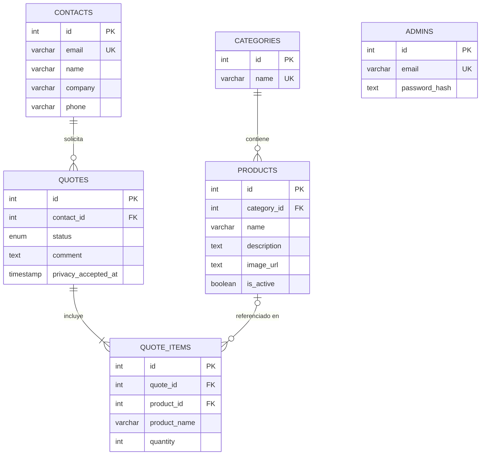

# Modelo de datos

## Diagrama

Todas las tablas incluyen `created_at`; `products`, `contacts` y `quotes` incluyen además `updated_at`.

## Reglas de integridad

| Relación | Al borrar | Motivo |
|---|---|---|
| Producto → Categoría | `RESTRICT` | No se puede borrar una categoría con productos |
| Cotización → Contacto | `RESTRICT` | Se preserva el historial de cotizaciones de cada contacto |
| Ítem → Cotización | `CASCADE` | Los ítems no existen sin su cotización |
| Ítem → Producto | `SET NULL` | El ítem conserva `product_name` aunque el producto se borre |

## Decisiones de diseño
- **Estados de cotización como `enum`**: la base rechaza cualquier valor fuera de `nueva`, `en_proceso`, `respondida`, `cerrada`.
- **Email único en contactos**: un contacto por email, reutilizado en cada nueva cotización.
- **Copia del nombre del producto en cada ítem**: una cotización siempre muestra lo que el cliente pidió, aunque el catálogo cambie.
- **Cantidad mayor a cero**: restricción `CHECK` a nivel base de datos.
- **Baja lógica de productos** (`is_active`): desactivar en lugar de borrar mantiene el historial intacto.
- **Consentimiento con fecha** (`privacy_accepted_at`): registra cuándo se aceptó la política de privacidad.
- **Contraseñas como hash**: nunca se almacena la contraseña real de un admin.
- **IDs con `GENERATED ALWAYS AS IDENTITY`**: estándar SQL moderno en PostgreSQL, en lugar de `serial`.
- **Timestamps con zona horaria**: evitan errores al operar entre servidores y usuarios en distintas zonas.